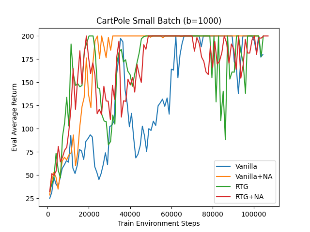
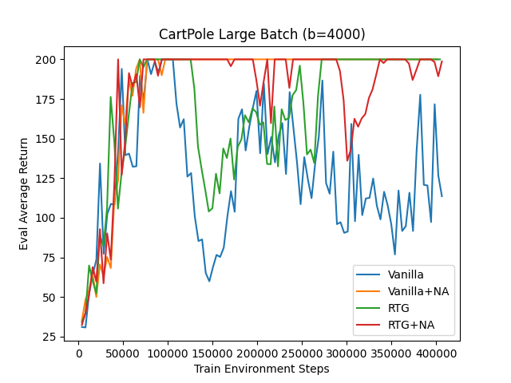
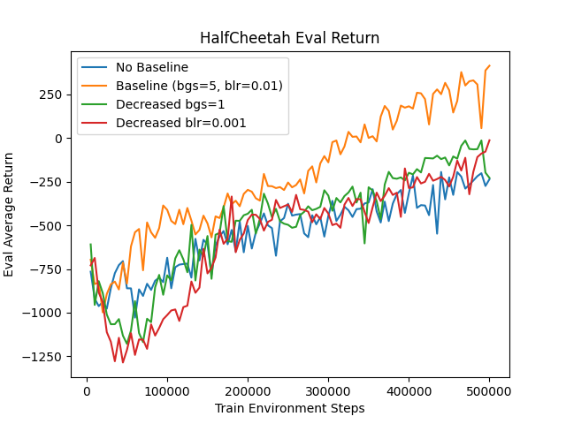
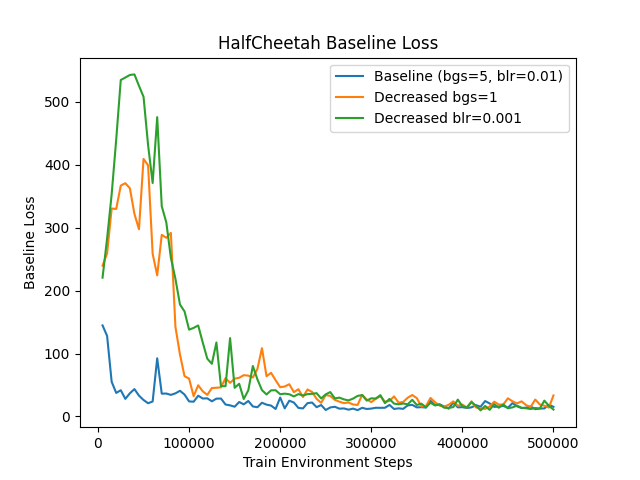
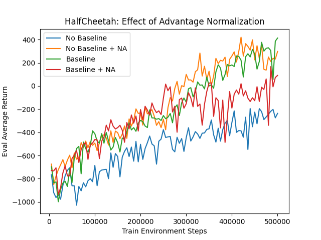
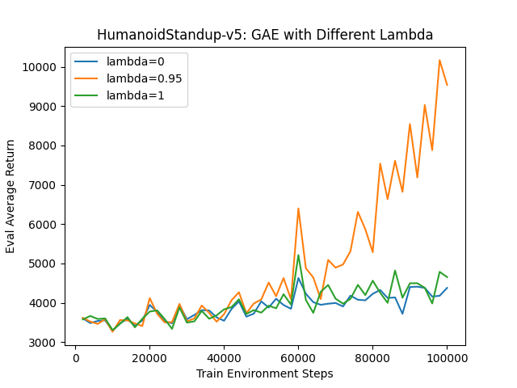
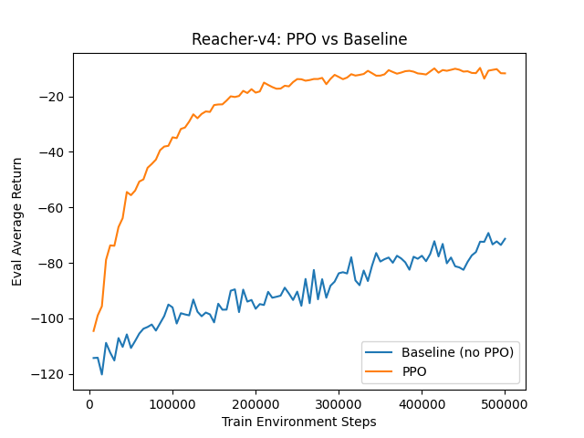

# HW2: Policy Gradients

**Course:** CAS4160 — Reinforcement Learning (Yonsei University)  
**Environments:** CartPole-v1 · HalfCheetah-v4 · Reacher-v4 · Humanoid-v4

---

## Overview

This homework implements the **Policy Gradient** family of algorithms, starting from vanilla REINFORCE and building up to PPO:

| Algorithm | Key Idea |
|---|---|
| REINFORCE | Baseline-free; high variance |
| REINFORCE + baseline | Subtract value baseline to reduce variance |
| Advantage normalization | Zero-mean, unit-std advantages |
| GAE(λ) | Generalized Advantage Estimation — bias/variance tradeoff |
| PPO | Clipped surrogate objective for stable updates |

---

## Results

### CartPole-v1 — Batch Size Comparison

Small batch (high variance):



Large batch (lower variance, more stable):



---

### HalfCheetah-v4 — Baseline and Normalization

Evaluation return:



Baseline loss:



Effect of advantage normalization:



---

### Humanoid-v4 — GAE

GAE with different λ values on the high-dimensional Humanoid environment:



---

### Reacher-v4 — PPO

PPO with clipped surrogate objective:



---

## Project Structure

```
hw2/
├── cas4160/
│   ├── agents/
│   │   └── pg_agent.py          # PG agent: Q-values, advantages, updates
│   ├── networks/
│   │   ├── policies.py          # MLPPolicy, MLPPolicyPG, PPO update
│   │   └── critics.py           # ValueCritic (baseline)
│   ├── infrastructure/
│   │   ├── utils.py             # Rollout collection
│   │   └── pytorch_util.py
│   └── scripts/
│       └── run_hw2.py           # Entry point
├── images/                      # Result plots
├── latex/                       # Report (LaTeX source)
├── tests/                       # Unit tests
├── requirements.txt
└── setup.py
```

---

## Setup

```bash
conda create -n cas4160 python=3.10 -y
conda activate cas4160
pip install -r requirements.txt
pip install -e .
```

---

## Running Experiments

```bash
# CartPole — small batch
python cas4160/scripts/run_hw2.py \
    --env_name CartPole-v1 --exp_name pg_cartpole_small \
    --n_iter 100 --batch_size 1000

# CartPole — large batch
python cas4160/scripts/run_hw2.py \
    --env_name CartPole-v1 --exp_name pg_cartpole_large \
    --n_iter 100 --batch_size 5000

# HalfCheetah with baseline
python cas4160/scripts/run_hw2.py \
    --env_name HalfCheetah-v4 --exp_name pg_cheetah \
    --use_baseline --normalize_advantages

# Humanoid with GAE
python cas4160/scripts/run_hw2.py \
    --env_name Humanoid-v4 --exp_name pg_humanoid_gae \
    --use_baseline --gae_lambda 0.98

# Reacher with PPO
python cas4160/scripts/run_hw2.py \
    --env_name Reacher-v4 --exp_name pg_reacher_ppo \
    --use_baseline --use_ppo --ppo_cliprange 0.2
```

### Visualize

```bash
tensorboard --logdir data
```

---

## Key Findings

- **Larger batches** reduce variance and improve convergence stability on CartPole.
- **Baseline subtraction** significantly reduces variance without introducing bias.
- **Advantage normalization** helps stabilize training across environments.
- **GAE(λ)** provides a smooth bias-variance tradeoff — critical for high-dimensional environments like Humanoid.
- **PPO** improves sample efficiency over vanilla PG by reusing samples with clipped importance weights.
